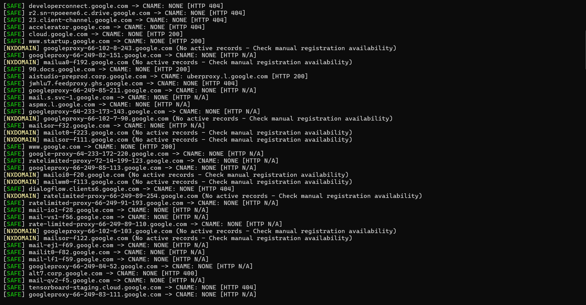

# subtake
SubTake is a multithreaded Python-based subdomain takeover detection and triage tool that analyzes DNS CNAME records and HTTP response fingerprints for authorized bug bounty and security testing.
___
## SubTake in Action

Here is SubTake scanning subdomains and displaying DNS and HTTP status results.



___
# SubTake

**SubTake** is a Python-based subdomain takeover triage tool for authorized bug bounty and security testing. It checks a list of subdomains, inspects DNS A/CNAME records, probes HTTP(S) responses, and compares the results with known hosting-service fingerprints.

> **Important:** SubTake is a triage aid, not proof of exploitability. Treat every finding as a lead that requires manual verification. A matching page or CNAME can be stale, customized, or otherwise misleading.

## Features

- Reads targets from a newline-separated text file.
- Checks DNS A records and follows available CNAME links.
- Detects `NXDOMAIN` responses and reports them for manual review.
- Probes HTTPS first, then falls back to HTTP.
- Matches CNAME and response-body indicators for services including GitHub Pages, AWS S3, Fastly, Zendesk, Shopify, Heroku, Tumblr, Squarespace, WordPress, Ghost, Cargo Collective, Webflow, and Pantheon.
- Uses a thread pool to process multiple subdomains concurrently.
- Prints color-coded terminal results for quick triage.

## Requirements

- Python 3.9 or newer
- Network access to the DNS resolvers and HTTP(S) services being tested
- Python packages: `dnspython`, `requests`

## Installation

Clone your repository and enter its directory:

```bash
git clone https://github.com/f4rhn-x/subtake.git
cd subtake
```

Install dependencies:

```bash
python3 -m pip install dnspython requests
```

If you save the script as `subtake`, make it executable:

```bash
chmod +x subtake
mv subtake /usr/local/bin
```

## Usage

Create a file containing one authorized subdomain per line, for example `targets.txt`:

```text
app.example.com
docs.example.com
status.example.com
```

Run the scanner:

```bash
subtake targets.txt
```

Choose the number of worker threads (default: `20`):

```bash
targets.txt 10
```

Or, if the script is executable:

```bash
subtake targets.txt 20
```

Only scan domains that you own or are explicitly authorized to test. Follow the relevant bug bounty program's scope, rate limits, and testing rules.

## Understanding the output

- **VULNERABLE (100% Match):** Both a configured CNAME indicator and a response-body fingerprint matched. This is a strong signal for investigation, **not a guarantee** that takeover is possible.
- **EDGE-CASE VULNERABLE (Body Fingerprint Match):** A response-body indicator matched without the expected CNAME match. Verify manually.
- **POTENTIAL (Dangling CNAME Found):** A CNAME indicator matched, but the expected response-body indicator did not. Check whether the external resource can actually be claimed.
- **NXDOMAIN:** DNS returned a non-existent-domain response. This alone does not establish a subdomain takeover.
- **SAFE:** No configured fingerprint matched. This does **not** prove the host is safe; the tool only checks its current signatures.

## Limitations

- Fingerprints can become outdated as hosting providers change their error pages and DNS behavior.
- The scanner does not attempt to claim resources or exploit a suspected takeover.
- The current implementation disables TLS certificate verification for HTTP requests, so certificate errors may go unnoticed.
- DNS and HTTP failures may be inconclusive; a missing response is not proof of vulnerability.
- Results are printed to the terminal; the current version does not export JSON or CSV reports.
- The script uses concurrent requests. Set a conservative thread count and respect program-defined rate limits.

## Responsible use

Use SubTake only for systems within your explicit authorization. Do not register, claim, or modify a third-party resource based solely on a scanner result. Confirm findings safely, document the evidence, and follow the target program's disclosure policy.

## Contributing

Issues, updated service fingerprints, bug reports, and pull requests are welcome. Please include reproducible evidence and avoid submitting secrets or sensitive target data.

## License

No license has been specified yet. Add a `LICENSE` file before publishing if you want others to have clear permission to use, modify, and redistribute this project.
